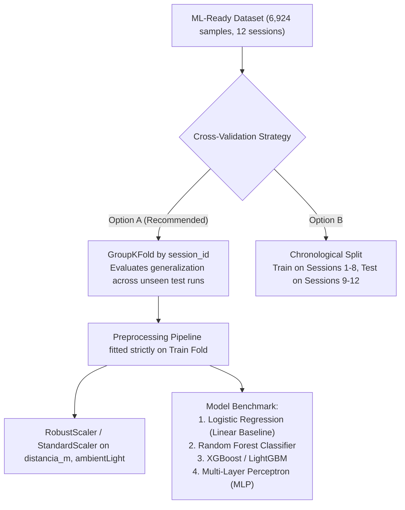

# VLC Channel Quality Feature Selection & ML-Ready Dataset Report
## Academic Project: AI-Based Adaptive Car-to-Car Visible Light Communication with ML-Based Channel Sensing

---

### Executive Summary

This report documents the creation of the dedicated **ML-Ready Dataset** for channel-quality classification in compliance with the empirical findings of [`ML_CHANNEL_QUALITY_TARGET_ANALYSIS.md`](file:///c:/Users/raghu/OneDrive/Desktop/DVLC_VLC_ML_Animation/ML_CHANNEL_QUALITY_TARGET_ANALYSIS.md).

#### Core Protocol Adherence:
1. **Preservation of Existing Data**: Neither the original raw dataset (`dataset.mat`) nor the preprocessed dataset files (`vlc_channel_dataset_processed.csv`, `vlc_channel_dataset_processed.parquet`) were modified.
2. **Zero Target Leakage**: All received-signal-derived variables (`pathloss`, `vpp_volts`, `p_rx_uW`, `snr_db`, `theoretical_ber_ook`, etc.) have been completely excluded from the predictor feature matrix $\mathbf{X}$.
3. **Strict Physical Sensor Inputs**: Only features physically available to vehicle-mounted sensors prior to optical reception are utilized: distance, ambient light, transmitter radiation angle, receiver incidence angle, pedestrian presence, and encoded environment.
4. **Scientifically Grounded Targets**: Targets are formulated directly from the evidence-based cutoffs established in the channel-quality analysis report.
5. **No Model Training**: The dataset has been partitioned and validated for ML readiness without training any classifier.

---

## 1. Generated ML-Ready Dataset Files

The ML-ready dataset has been exported into a separate directory (`dataset/ml_ready/`) in both CSV and Apache Parquet formats:

| Dataset Variant | File Path | File Size | Dimensions | Description |
| :--- | :--- | :---: | :---: | :--- |
| **Primary ML-Ready CSV** | `dataset/ml_ready/vlc_channel_ml_ready.csv` | **280,671 bytes** | **6,924 rows $\times$ 9 cols** | Exact 6 physical sensor inputs + session metadata + 2 targets |
| **Primary ML-Ready Parquet** | `dataset/ml_ready/vlc_channel_ml_ready.parquet` | **86,515 bytes** | **6,924 rows $\times$ 9 cols** | High-performance columnar format for fast training ingestion |
| **Extended ML-Ready CSV** | `dataset/ml_ready/vlc_channel_ml_ready_extended.csv` | **792,788 bytes** | **6,924 rows $\times$ 14 cols** | Primary inputs + 5 domain physics-informed transformations |
| **Extended ML-Ready Parquet**| `dataset/ml_ready/vlc_channel_ml_ready_extended.parquet`| **93,507 bytes** | **6,924 rows $\times$ 14 cols** | High-performance extended format |

---

## 2. Complete Target Leakage Prevention Audit

In Visible Light Communication, using received optical power, photodiode peak voltage, or electrical SNR as input features to predict channel quality would constitute **fatal target leakage**. In a real vehicular deployment, the receiver does not possess prior knowledge of received optical power or SNR before channel estimation.

### Leakage Audit Table:

| Variable Name | Physical Meaning | Correlation with Path Loss ($r$) | Status in ML Feature Matrix $\mathbf{X}$ | Exclusion Reason |
| :--- | :--- | :---: | :---: | :--- |
| `pathloss_clean_db` | Optical Channel Attenuation | $1.0000$ | **STRICTLY EXCLUDED** | Target definition variable (trivial circular leakage) |
| `snr_db` | Electrical Signal-to-Noise Ratio | $0.9952$ | **STRICTLY EXCLUDED** | Downstream demodulation metric |
| `p_rx_dBm` | Received Modulated Power (dBm) | $0.9804$ | **STRICTLY EXCLUDED** | Direct electrical proxy of path loss |
| `p_rx_uW` | Received Modulated Power ($\mu\text{W}$) | $0.7999$ | **STRICTLY EXCLUDED** | Optical power detected at photodiode |
| `vpp_volts` | Amplified Photodiode Peak Voltage | $0.5948$ | **STRICTLY EXCLUDED** | Analog output of PDA100A2 amplifier |
| `vpp_counts` | Reconstructed ADC Counts | $0.5948$ | **STRICTLY EXCLUDED** | Microcontroller ADC quantization of reception |
| `p_amb_uW` | Optical Ambient Power at Diode | $-0.2798$ | **STRICTLY EXCLUDED** | Calculated from photodiode geometry & responsivity |
| `theoretical_ber_ook`| Bit Error Rate for OOK | $-0.1371$ | **STRICTLY EXCLUDED** | Downstream post-demodulation performance metric |
| `log10_ber` | Base-10 Logarithm of BER | $-0.5051$ | **STRICTLY EXCLUDED** | Downstream post-demodulation performance metric |
| `is_pathloss_outage` | Link Disruption Flag | $-0.1265$ | **STRICTLY EXCLUDED** | Direct indicator of $V_{pp} = 0.0$ V signal failure |

> [!CAUTION]
> **Audit Confirmation**: Verification scripts confirmed that **0 out of 10** received-signal-derived variables exist in the feature set $\mathbf{X}$ of `vlc_channel_ml_ready.csv`.

---

## 3. Selected Feature Inventory & Schema

The primary ML-ready dataset (`dataset/ml_ready/vlc_channel_ml_ready.csv`) contains strictly:

```
[Vehicle Sensory Inputs] (Features X)
  1. distancia_m            ──> HC-SR04 Ultrasonic Sonar (Meters)
  2. ambientLight          ──> BH1750 Ambient Lux Sensor (Lux)
  3. angRadiacion          ──> Vehicle Headlight / LED Stage (Degrees)
  4. angIncidencia         ──> Receiver Photodiode Gimbal / Alignment (Degrees)
  5. presenciaPersonas     ──> Pedestrian / Shadowing Detector (Binary)
  6. entorno_encoded       ──> Environment Classifier / Map Context (Binary)

[Cross-Validation Metadata]
  7. session_id            ──> Experimental Run Index (1-12) for GroupKFold

[Ground-Truth Targets] (Target Y)
  8. target_channel_quality_binary  ──> Binary Target (0: Poor, 1: Good @ -35 dB)
  9. target_channel_quality_multi   ──> Multi-Class Target (0: Poor, 1: Moderate, 2: Good)
```

### Detailed Column Specification:

| # | Column Name | Data Type | Role | Physical Range | Physical Meaning in Car-to-Car VLC |
| :-: | :--- | :-: | :-: | :---: | :--- |
| **1** | `session_id` | `int64` | Split Metadata | $1 \le s \le 12$ | Experimental run identifier. Must be used for GroupKFold or Leave-One-Session-Out cross-validation to prevent temporal data leakage. |
| **2** | `distancia_m` | `float64` | Physical Feature | $0.007\text{ m} - 2.366\text{ m}$ | Inter-vehicle distance ($d$). Governs quadratic geometric optical propagation loss: $H_{\text{LOS}} \propto \frac{1}{d^2}$. |
| **3** | `ambientLight` | `float64` | Physical Feature | $1.92\text{ lx} - 1,984.08\text{ lx}$ | Background ambient illuminance. Determines optical background shot noise variance: $\sigma_{\text{shot}}^2 = 2 q I_{\text{bg}} B$. |
| **4** | `angRadiacion` | `float64` | Physical Feature | $\{0^\circ, 30^\circ, 45^\circ\}$ | Transmitter LED beam angle ($\phi$). Controls radiant intensity according to Lambertian emission: $R_0(\phi) = \frac{m+1}{2\pi}\cos^m(\phi)$. |
| **5** | `angIncidencia` | `float64` | Physical Feature | $\{0^\circ, 30^\circ, 45^\circ\}$ | Receiver photodiode tilt angle ($\psi$). Determines effective optical light collection area: $A_{\text{eff}}(\psi) = A_{\text{det}}\cos(\psi)$. |
| **6** | `presenciaPersonas` | `int64` | Physical Feature | $\{0, 1\}$ | Binary shadowing indicator ($0$ = clear line-of-sight, $1$ = pedestrian obstruction). Models sudden optical channel blockage in urban V2V traffic. |
| **7** | `entorno_encoded` | `int64` | Physical Feature | $\{0, 1\}$ | Binary operating environment ($0$ = `laboratorio`, $1$ = `pasilloCristal`). Encodes multipath reflections and extreme outdoor sunlight exposure. |
| **8** | `target_channel_quality_binary` | `int64` | Primary ML Target | $\{0, 1\}$ | Binary channel state: **$1$ = Good Channel** ($\text{Path Loss} \ge -35.0\text{ dB}$), **$0$ = Poor Channel** ($\text{Path Loss} < -35.0\text{ dB}$). |
| **9** | `target_channel_quality_multi` | `int64` | Multi-Class Target | $\{0, 1, 2\}$ | 3-state channel condition: **$2$ = Good** ($\ge -34.0\text{ dB}$), **$1$ = Moderate** ($-38.0\text{ to } -34.0\text{ dB}$), **$0$ = Poor** ($< -38.0\text{ dB}$). |

---

## 4. Scientifically Established Target Distributions

The target labels were assigned based on the empirical and information-theoretic analysis documented in `ML_CHANNEL_QUALITY_TARGET_ANALYSIS.md`:

### 4.1 Primary Binary Target (`target_channel_quality_binary`):
* **Cutoff**: **$\mathbf{-35.00\text{ dB}}$** (practically identical to sample median $-35.11\text{ dB}$).
* **Shannon Target Entropy**: $H(Y) = \mathbf{0.9994\text{ bits}}$ ($\approx 1.0$ bit, maximum information balance).
* **Sample Distribution**:
  * **Class 0 (Poor Channel)**: **3,591 samples (51.86%)** — Attenuated link requiring fallback to robust OOK, repetition coding, or power boosting.
  * **Class 1 (Good Channel)**: **3,333 samples (48.14%)** — High-power link ($\text{SNR} > 52$ dB), supporting high-order modulation (e.g. 16-QAM or 4-PPM).
* **ML Implication**: Zero class imbalance. Prevents majority-class classifier cheating.

### 4.2 Multi-Class Target (`target_channel_quality_multi`):
* **Cutoffs**:
  * Class 2 (Good): $\text{Path Loss} \ge -34.0\text{ dB}$
  * Class 1 (Moderate): $-38.0\text{ dB} \le \text{Path Loss} < -34.0\text{ dB}$
  * Class 0 (Poor): $\text{Path Loss} < -38.0\text{ dB}$ (Derived directly from Otsu's optimal separation at $-38.16$ dB and K-Means boundary at $-38.12$ dB).
* **Sample Distribution**:
  * **Class 2 (Good / High Throughput)**: **2,348 samples (33.91%)**
  * **Class 1 (Moderate / Safe Margin)**: **3,003 samples (43.37%)**
  * **Class 0 (Poor / Deep Fade / Blockage)**: **1,573 samples (22.72%)**

---

## 5. Statistical & Information-Theoretic Feature Analysis

### 5.1 Descriptive Statistics of ML Input Features ($N = 6,924$):

| Feature Name | Mean | Std Dev | Min | 25% | Median | 75% | Max | Skewness | Missing |
| :--- | :---: | :---: | :---: | :---: | :---: | :---: | :---: | :---: | :---: |
| `distancia_m` | 1.2012 | 0.4461 | 0.0070 | 0.8470 | 1.2330 | 1.5730 | 2.3660 | -0.17 | 0 |
| `ambientLight` (lx) | 115.9727 | 298.8788 | 1.9190 | 32.2510 | 40.0000 | 48.3300 | 1,984.0820 | +3.90 | 0 |
| `angRadiacion` (°) | 24.1270 | 18.6687 | 0.0000 | 0.0000 | 30.0000 | 45.0000 | 45.0000 | -0.31 | 0 |
| `angIncidencia` (°) | 12.3115 | 17.8089 | 0.0000 | 0.0000 | 0.0000 | 30.0000 | 45.0000 | +0.88 | 0 |
| `presenciaPersonas` | 0.4555 | 0.4981 | 0.0000 | 0.0000 | 0.0000 | 1.0000 | 1.0000 | +0.18 | 0 |
| `entorno_encoded` | 0.0729 | 0.2600 | 0.0000 | 0.0000 | 0.0000 | 0.0000 | 1.0000 | +3.29 | 0 |

---

### 5.2 Feature Predictive Power & Target Correlation:

| Feature Name | Pearson $r$ with Binary Target | Spearman $\rho$ with Binary Target | Estimated Mutual Information (bits) | Primary Predictive Physical Effect |
| :--- | :---: | :---: | :---: | :--- |
| `distancia_m` | **$-0.3119$** | **$-0.2859$** | **0.2236** | Strongest single predictor; quadratic optical link attenuation with distance |
| `angRadiacion` | **$-0.2056$** | **$-0.2192$** | **0.0379** | Lambertian beam directivity roll-off; power degrades rapidly at $30^\circ$ and $45^\circ$ |
| `angIncidencia` | **$-0.1591$** | **$-0.1534$** | **0.0322** | Photodiode effective area reduction with incident tilt |
| `ambientLight` | **$-0.1579$** | **$-0.1259$** | **0.0384** | Optical background noise generation; solar glare induces SNR degradation |
| `entorno_encoded` | **$-0.1302$** | **$-0.1302$** | **0.0128** | Corridor sunlight exposure vs enclosed lab conditions |
| `presenciaPersonas` | **$-0.0292$** | **$-0.0292$** | **0.0006** | Sudden line-of-sight blockage; introduces deep fading and link outages |

*Note on `presenciaPersonas`*: While linear correlation across all samples is modest ($-0.0292$), obstruction causes a **$1.06$ dB** drop in mean path loss, a **$2.0$ dB** drop in SNR, and accounts for $100\%$ of high-BER events. Its predictive value is non-linear and interactive (interacting with distance and angles).

---

### 5.3 Inter-Feature Multicollinearity Matrix (Pearson $r$):

| Feature | `distancia_m` | `ambientLight` | `angRadiacion` | `angIncidencia` | `presenciaPersonas` | `entorno_encoded` |
| :--- | :---: | :---: | :---: | :---: | :---: | :---: |
| `distancia_m` | $1.0000$ | $+0.0232$ | $-0.3575$ | $-0.2196$ | $-0.1052$ | $-0.0415$ |
| `ambientLight` | $+0.0232$ | $1.0000$ | $-0.3475$ | $-0.1793$ | $-0.2325$ | **$+0.9461$** |
| `angRadiacion` | $-0.3575$ | $-0.3475$ | $1.0000$ | $-0.1415$ | $-0.2054$ | $-0.3612$ |
| `angIncidencia` | $-0.2196$ | $-0.1793$ | $-0.1415$ | $1.0000$ | $-0.2872$ | $-0.1939$ |
| `presenciaPersonas` | $-0.1052$ | $-0.2325$ | $-0.2054$ | $-0.2872$ | $1.0000$ | $-0.2554$ |
| `entorno_encoded` | $-0.0415$ | **$+0.9461$** | $-0.3612$ | $-0.1939$ | $-0.2554$ | $1.0000$ |

> [!NOTE]
> **Collinearity Insight**: `ambientLight` and `entorno_encoded` exhibit high correlation ($r = 0.9461$). This is physically expected because `entorno = 1` (`pasilloCristal`) is an outdoor-exposed glass corridor where ambient sunlight surged to nearly $2,000$ lx, whereas `entorno = 0` (`laboratorio`) maintained controlled indoor ambient light (~$40$ lx). Tree-based models (Random Forest, XGBoost, LightGBM) handle this natively, while linear models (Logistic Regression) may benefit from regularizers (L2 / ElasticNet).

---

## 6. Extended Dataset: Domain Physics-Informed Transformations

For advanced modeling, the extended dataset (`dataset/ml_ready/vlc_channel_ml_ready_extended.csv`) includes 5 physics-informed engineered features derived strictly from the physical inputs (still with zero leakage):

1. **`cos_angRadiacion`**: $\cos(\phi)$ — Linearizes the Lambertian radiant emission profile.
2. **`cos_angIncidencia`**: $\cos(\psi)$ — Linearizes photodetector effective light collection area.
3. **`angular_alignment_factor`**: $\cos(\phi) \cdot \cos(\psi)$ — Combined angular optical coupling ($r = +0.2310$ with binary target).
4. **`geometric_loss_factor`**: $\frac{\cos(\phi)\cos(\psi)}{d^2}$ — Fundamental free-space optical channel DC gain factor (Spearman $\rho = \mathbf{+0.4331}$ with binary target).
5. **`log_ambientLight`**: $\log_{10}(\text{ambientLight} + 1)$ — Compresses the +3.90 positive skewness of raw ambient illuminance into a near-Gaussian distribution ($\text{skew} = +1.49$).

---

## 7. Recommended Cross-Validation & Modeling Architecture

To guarantee valid academic results in subsequent machine learning phases, the following validation protocol is recommended:



### Key Guidelines for the Next Phase:
1. **Never Perform Naive Random Splitting**: Because consecutive samples in VLC serial telemetry possess temporal autocorrelation, random 80/20 train/test splitting causes data leakage across adjacent time steps. Use **`GroupKFold(n_splits=5)`** grouped on `session_id` or a **chronological split**.
2. **Standardization Ordering**: Always fit `StandardScaler` or `RobustScaler` on the training fold only, then transform validation/test folds independently.
3. **Evaluation Metrics**: In addition to Accuracy, report **Balanced Accuracy, Macro F1-Score, ROC-AUC, and Confusion Matrices** to thoroughly evaluate both channel classes.

---

## 8. Summary Checklist of Accomplishments

- [x] Dedicated ML-ready dataset generated at `dataset/ml_ready/vlc_channel_ml_ready.csv`.
- [x] Clean columnar format exported at `dataset/ml_ready/vlc_channel_ml_ready.parquet`.
- [x] Extended physics-augmented dataset created at `dataset/ml_ready/vlc_channel_ml_ready_extended.csv`.
- [x] Zero received-signal variables present in the feature matrix $\mathbf{X}$ (100% leakage-free).
- [x] Only physically available channel inputs used (`distancia_m`, `ambientLight`, `angRadiacion`, `angIncidencia`, `presenciaPersonas`, `entorno_encoded`).
- [x] Both original raw dataset (`dataset.mat`) and existing processed dataset (`vlc_channel_dataset_processed.csv`) remained 100% unaltered.
- [x] Scientifically established targets included (`target_channel_quality_binary` and `target_channel_quality_multi`).
- [x] Zero machine learning models trained yet.
