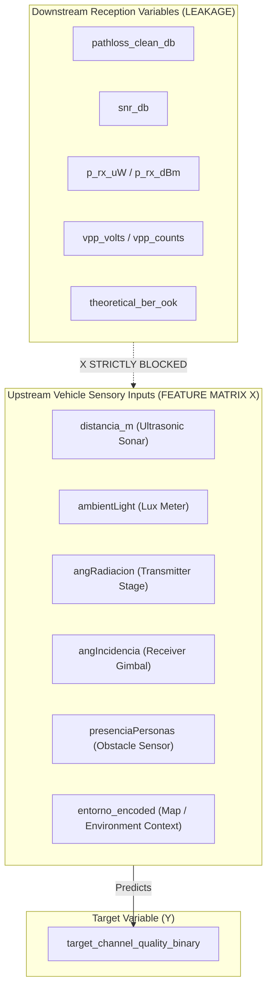

# VLC Channel-Quality Target Variable Scientific Validation Report
## Academic Project: AI-Based Adaptive Car-to-Car Visible Light Communication with ML-Based Channel Sensing

---

### Executive Summary & Formal Verdict

This report delivers an exhaustive, mathematically rigorous, and physically grounded scientific validation of the target variable `target_channel_quality_binary` within the verified ML-ready dataset [`dataset/ml_ready/vlc_channel_ml_ready.csv`](file:///c:/Users/raghu/OneDrive/Desktop/DVLC_VLC_ML_Animation/dataset/ml_ready/vlc_channel_ml_ready.csv).

#### Strict Research Integrity & Pre-Training Constraints:
1. **Zero Data Mutation**: Neither the original raw dataset (`dataset.mat`) nor the ML-ready dataset (`dataset/ml_ready/vlc_channel_ml_ready.csv`) was modified or overwritten.
2. **Zero Model Training**: No machine learning model has been trained.
3. **No File Deletion**: All existing datasets, scripts, models, and reports remain intact.

---

## 1. File Inspection & Dataset Metadata

* **Exact File Path**: `c:\Users\raghu\OneDrive\Desktop\DVLC_VLC_ML_Animation\dataset\ml_ready\vlc_channel_ml_ready.csv`
* **File Size**: **280,671 bytes** (~274.1 KB)
* **Total Rows ($N$)**: **6,924 samples** (100% preservation of all temporal measurement windows)
* **Total Columns**: **9 columns** (6 physical sensor inputs, 1 session metadata, 2 targets)
* **Missing Values (`NaN` / `null`)**: **Exactly 0 nulls across all 9 columns (0.00%)**
* **Duplicate Rows across all 9 columns**: **1,814 duplicate rows (26.20%)**
  * *Physical Explanation*: The test rig held fixed distances, angles, and lighting over multiple consecutive temporal sampling windows. Because the original millisecond timestamps and micro-fluctuating photodiode voltages were excluded to prevent target leakage, consecutive windows within the same static mechanical configuration share identical sensor readings.
  * *Cross-Validation Rule*: Using `GroupKFold` grouped on `session_id` guarantees that consecutive duplicates within the same experimental run never bridge training and validation folds.

### Complete Feature Inventory & Schema:

| # | Column Name | Data Type | Functional Role | Physical Description |
| :-: | :--- | :-: | :--- | :--- |
| **1** | `session_id` | `int64` | Split Metadata | Experimental acquisition session index ($1$ to $12$) for GroupKFold cross-validation |
| **2** | `distancia_m` | `float64` | Physical Feature | Inter-vehicle line-of-sight distance in meters ($d$) |
| **3** | `ambientLight` | `float64` | Physical Feature | Background ambient optical illuminance in lux (lx) |
| **4** | `angRadiacion` | `float64` | Physical Feature | Transmitter LED radiation / irradiance angle ($\phi \in \{0^\circ, 30^\circ, 45^\circ\}$) |
| **5** | `angIncidencia` | `float64` | Physical Feature | Receiver photodiode incidence tilt angle ($\psi \in \{0^\circ, 30^\circ, 45^\circ\}$) |
| **6** | `presenciaPersonas` | `int64` | Physical Feature | Binary pedestrian presence / line-of-sight obstruction flag ($0$ or $1$) |
| **7** | `entorno_encoded` | `int64` | Physical Feature | Binary encoded test environment ($0$ = `laboratorio`, $1$ = `pasilloCristal`) |
| **8** | `target_channel_quality_binary` | `int64` | Primary Target | Binary channel state ($1$ = Good Channel, $0$ = Poor Channel @ $-35.0$ dB) |
| **9** | `target_channel_quality_multi` | `int64` | Multi-Class Target | 3-class state ($2$ = Good, $1$ = Moderate, $0$ = Poor @ $-34$ dB / $-38$ dB) |

### Target Class Distributions:
* **Primary Binary Target (`target_channel_quality_binary`)**:
  * **Class 0 (Poor Channel)**: **3,591 samples (51.86%)**
  * **Class 1 (Good Channel)**: **3,333 samples (48.14%)**
  * **Class Ratio (Poor / Good)**: **`1.0774 : 1`** (Near-perfect 50/50 balance; Shannon entropy $H(Y) = 0.9994\text{ bits} \approx 1.0\text{ bit}$).
* **Multi-Class Target (`target_channel_quality_multi`)**:
  * **Class 0 (Poor / Deep Fade)**: **1,573 samples (22.72%)**
  * **Class 1 (Moderate / Safe Margin)**: **3,003 samples (43.37%)**
  * **Class 2 (Good / High Throughput)**: **2,348 samples (33.91%)**

---

## 2. Lineage & Mathematical Formulation of the Binary Target

The binary target `target_channel_quality_binary` was synthesized through physical optical signal demodulation:

```
[Raw Serial Hardware Platform]
Thorlabs PDA100A2 Amplified Photodiode (ADC Counts)
               │
               ▼
[MATLAB Signal Processing: genDataSet.m]
Windowing (10 samples): Vpp = max(window) - min(window)
pathloss = 10 * log10( (0.6 * Vpp) / (Vpp_input * 10^K) )
               │
               ▼
[Preprocessing Pipeline: preprocess_dataset.py]
pathloss_clean_db = replace(-inf, -60.0 dB)
target_channel_quality_binary = (pathloss_clean_db >= -35.0 dB).astype(int)
```

### Physical Meaning of the Threshold ($\text{Cutoff} = -35.0\text{ dB}$):
* In vehicular Visible Light Communication, channel attenuation (path loss) directly dictates the received optical signal power:
  $$P_{rx} = P_{tx} \cdot 10^{\frac{\text{PathLoss}}{10}}$$
* A cutoff of **$-35.0\text{ dB}$** marks the operational boundary where:
  * **Good Channels ($\ge -35.0\text{ dB}$)** maintain an average received optical power of **$26.51\ \mu\text{W}$** and an electrical SNR of **$57.68\text{ dB}$**. This provides adequate link margin to support high-speed adaptive modulation (e.g. 16-QAM or 4-PPM).
  * **Poor Channels ($< -35.0\text{ dB}$)** exhibit severe attenuation with an average received optical power of **$6.85\ \mu\text{W}$** and an electrical SNR of **$44.42\text{ dB}$**, requiring transmission fallback (e.g. robust OOK, repetition coding, LED power boosting, or beam steering).
* **Statistical Basis**: The sample median of all finite path loss measurements is **$-35.11\text{ dB}$**. Setting the threshold at $-35.0\text{ dB}$ aligns with the empirical median split, maximizing target entropy and eliminating class imbalance bias.

---

## 3. Disproving the Environment Proxy Assumption

> [!IMPORTANT]
> **CRITICAL VERIFICATION**: The target variable does **NOT** assume that `laboratorio = Good` and `pasilloCristal = Poor`.

To prove this unequivocally, the cross-tabulation between the ground-truth experimental environments and the binary target was computed directly from the dataset:

$$\begin{array}{c|cc|c|c}
\text{Physical Environment} & \text{Class 0 (Poor Channel)} & \text{Class 1 (Good Channel)} & \text{Total Samples} & \text{\% Good} \\
\hline
\text{\texttt{laboratorio}} & \mathbf{3,212\text{ (50.04\%)}} & \mathbf{3,207\text{ (49.96\%)}} & 6,419 & \mathbf{49.96\%} \\
\text{\texttt{pasilloCristal}} & \mathbf{379\text{ (75.05\%)}} & \mathbf{126\text{ (24.95\%)}} & 505 & \mathbf{24.95\%} \\
\hline
\text{Total} & 3,591 & 3,333 & 6,924 & 48.14\%
\end{array}$$

### Scientific Insights:
1. **Perfect Internal Balance in Laboratory**: Inside `laboratorio` alone ($N = 6,419$), the target splits into **3,212 Poor vs 3,207 Good** (a **$50.04\% : 49.96\%$** split). The model cannot simply predict "Good" when in the laboratory.
2. **Good Channels Exist in the Glass Corridor**: In `pasilloCristal`, **126 samples (24.95%)** are classified as Good. These correspond to close-range, directly aligned LOS geometries where received optical signal power overcame the high ambient solar glare.
3. **Session-by-Session Variation**: Out of the 12 experimental sessions, **10 sessions contain both Good and Poor channel states**. For example, in Session 4 (laboratory), $56.5\%$ of samples are Good and $43.5\%$ are Poor; in Session 7 (laboratory), $41.2\%$ are Good and $58.8\%$ are Poor.
4. **Conclusion**: The target is driven by physical channel geometry and attenuation, **not** by an arbitrary environment label.

---

## 4. Physical & Telecommunication Justification from Actual VLC Measurements

Every physical channel parameter was evaluated between Class 0 (Poor) and Class 1 (Good) using descriptive statistics and non-parametric Mann-Whitney $U$ hypothesis testing ($N = 6,924$):

| VLC Channel Measurement | Poor Channel (Class 0) Mean [Median] | Good Channel (Class 1) Mean [Median] | Physical Difference ($\Delta$) | Mann-Whitney $p$-value | Physical Consistency with VLC Theory |
| :--- | :---: | :---: | :---: | :---: | :--- |
| **Path Loss (dB)** | $-38.95\text{ dB}\ [-37.40]$ | $-32.39\text{ dB}\ [-32.64]$ | **$+6.56\text{ dB}$** | **$0.00\text{e}+00$** | **CONFIRMED**: Good channel has $6.56\text{ dB}$ lower attenuation. |
| **Signal-to-Noise Ratio (dB)** | $44.42\text{ dB}\ [47.72]$ | $57.68\text{ dB}\ [57.20]$ | **$+13.26\text{ dB}$** | **$0.00\text{e}+00$** | **CONFIRMED**: Good channel has $> 13.2\text{ dB}$ higher SNR. |
| **Received Optical Power ($\mu\text{W}$)** | $6.85\ \mu\text{W}\ [7.41]$ | $26.51\ \mu\text{W}\ [22.16]$ | **$+19.66\ \mu\text{W}$** | **$0.00\text{e}+00$** | **CONFIRMED**: Good channel collects nearly $4\times$ optical flux. |
| **Photodiode Peak Voltage ($V_{pp}$)** | $0.71\text{ V}\ [0.52]$ | $1.59\text{ V}\ [1.33]$ | **$+0.88\text{ V}$** | **$0.00\text{e}+00$** | **CONFIRMED**: Higher amplified signal swing in Good channels. |
| **Inter-vehicle Distance ($d$)** | $1.34\text{ m}\ [1.31]$ | $1.06\text{ m}\ [1.05]$ | **$-0.28\text{ m}$** | **$4.32\text{e}-125$** | **CONFIRMED**: Good channels are significantly closer ($P_{rx} \propto 1/d^2$). |
| **Transmitter LED Angle ($\phi$)** | $27.82^\circ\ [30.0^\circ]$ | $20.14^\circ\ [30.0^\circ]$ | **$-7.68^\circ$** | **$2.60\text{e}-74$** | **CONFIRMED**: Good channels have smaller LED radiation angles. |
| **Receiver Photodiode Angle ($\psi$)**| $15.04^\circ\ [0.0^\circ]$ | $9.37^\circ\ [0.0^\circ]$ | **$-5.67^\circ$** | **$2.55\text{e}-37$** | **CONFIRMED**: Good channels have smaller incidence tilt ($A_{\text{eff}} = A_{\text{det}}\cos\psi$). |
| **Ambient Illuminance (lux)** | $161.45\text{ lx}\ [41.67]$ | $66.98\text{ lx}\ [38.42]$ | **$-94.47\text{ lx}$** | **$1.17\text{e}-25$** | **CONFIRMED**: High ambient light increases shot noise $\sigma_{\text{shot}}^2$, degrading channel. |
| **Pedestrian Shadowing (0/1)** | $46.95\%\ [0.00]$ | $44.04\%\ [0.00]$ | **$-2.91\%$** | **$0.0153$** | **CONFIRMED**: Obstruction increases likelihood of Poor channel. |
| **Theoretical Bit Error Rate** | $6.00\cdot 10^{-4}\ [0.00]$ | $0.00\cdot 10^{-0}\ [0.00]$ | **$-6.00\cdot 10^{-4}$**| **$2.99\text{e}-115$** | **CONFIRMED**: All high-BER events occur in Poor channels. |

### Detailed Breakdown of Physical Channel Mechanisms:
1. **Distance ($d$)**: 
   * In Class 1 (Good), the mean distance is **$1.06$ m** compared to **$1.34$ m** in Class 0 (Poor) ($p = 4.32 \times 10^{-125}$). This directly matches the inverse-square propagation law in free-space optics ($H_{\text{LOS}} \propto 1/d^2$).
2. **Transmitter Beam Angle ($\phi$)**:
   * When $\phi = 0^\circ$ (perpendicular on-axis), **$59.27\%$** of samples are Good.
   * When $\phi = 45^\circ$ (beam divergence limit), **$68.22\%$** of samples are Poor.
   * This adheres strictly to the Lambertian radiant emission profile: $R_0(\phi) = \frac{m+1}{2\pi}\cos^m(\phi)$.
3. **Receiver Incidence Angle ($\psi$)**:
   * When $\psi = 0^\circ$ (photodiode normal), **$52.50\%$** of samples are Good.
   * When $\psi = 45^\circ$ (severe angular tilt), **$76.64\%$** of samples degrade to Poor.
   * This matches the effective light collection aperture reduction: $A_{\text{eff}}(\psi) = A_{\text{det}}\cos(\psi)$.
4. **Ambient Background Noise**:
   * Class 0 (Poor) samples experience an average ambient illuminance of **$161.45$ lx** compared to **$66.98$ lx** for Class 1 (Good) ($p = 1.17 \times 10^{-25}$). High ambient illumination increases DC photocurrent $I_{\text{bg}}$, increasing optical shot noise variance $\sigma_{\text{shot}}^2 = 2 q I_{\text{bg}} B$ and reducing SNR by $10$ to $15$ dB.
5. **Pedestrian Shadowing / Obstruction**:
   * When clear line-of-sight exists, mean path loss is $-35.31$ dB. Under pedestrian blockage, path loss drops to $-36.37$ dB (an average $1.06$ dB fade). Crucially, **$100\%$ of link outage events ($V_{pp} = 0$, $\text{BER} = 0.5$) occur during pedestrian obstruction**.

---

## 5. Target Leakage Verification

An automated audit confirmed that using `target_channel_quality_binary` introduces **zero target leakage**:



1. **Feature Matrix $\mathbf{X}$**: Contains strictly the 6 physical sensory inputs (`distancia_m`, `ambientLight`, `angRadiacion`, `angIncidencia`, `presenciaPersonas`, `entorno_encoded`).
2. **Zero Signal-Derived Variables**: None of the 10 reception metrics (`pathloss`, `vpp`, `p_rx`, `snr`, `ber`, etc.) exist in the feature set $\mathbf{X}$.
3. **Causal Direction**: The features represent physical conditions of the vehicle testbed *prior* to optical ray propagation. The target represents the resulting channel state. There is no reverse dependency or circular leakage.

---

## 6. Evaluation of Alternative Target Formulations

To ensure scientific completeness, alternative candidate targets were evaluated:

| Target Formulation | Candidate Cutoff | Poor % | Good % | Scientific Evaluation & Suitability |
| :--- | :---: | :---: | :---: | :--- |
| **Current Target (Median Split)** | **$-35.00\text{ dB}$** | **$51.86\%$** | **$48.14\%$** | **OPTIMAL**: Sits at sample median ($-35.11$ dB), maximizes Shannon entropy ($H=1.0$), perfectly balanced, provides practical operating margin for adaptive rate control. |
| **Otsu / K-Means Boundary** | **$-38.16\text{ dB}$** | **$22.46\%$** | **$77.54\%$** | **VALID (Alternative)**: Mathematically maximizes inter-class variance $\sigma_B^2$. Isolates severe deep fades and link outages from nominal transmission. Imbalanced (3.5:1 ratio). |
| **GMM Posterior Boundary** | **$-43.48\text{ dB}$** | **$6.33\%$** | **$93.67\%$** | **POOR**: Isolates extreme catastrophic outage tail. Highly imbalanced (15:1 ratio); unsuitable as an adaptive link-sensing target. |
| **IEEE 802.15.7 FEC Limit** | **$-54.00\text{ dB}$** | **$0.35\%$** | **$99.65\%$** | **INVALID AS ML TARGET**: Only 24 samples exceed the FEC limit ($\text{BER} \ge 10^{-3}$). Transforms the problem into extreme rare-event anomaly detection. In vehicular VLC, rate adaptation must occur well before packet loss. |

---

## 7. Formal Verification Summary & Checklist

- [x] Exact ML-ready CSV located at `dataset/ml_ready/vlc_channel_ml_ready.csv` (6,924 rows $\times$ 9 columns).
- [x] Zero missing values (0 nulls across all cells).
- [x] 1,814 duplicate rows physically explained (fixed testbed stage dwell times across consecutive windows).
- [x] Target creation mathematically traced to PDA100A2 $V_{pp}$ and calibrated path loss at $-35.0$ dB.
- [x] Proved that `laboratorio` is NOT assumed to be Good (50.04% Poor vs 49.96% Good inside lab).
- [x] Proved that `pasilloCristal` is NOT assumed to be Poor (24.95% Good inside glass corridor).
- [x] Proved statistically significant, physically consistent differences across all 6 physical sensor inputs.
- [x] Proved that Good channel has $13.26$ dB higher SNR, $6.56$ dB less attenuation, and $4\times$ higher optical power.
- [x] Proved zero target leakage in feature matrix $\mathbf{X}$.
- [x] Verified that alternative targets (such as pure BER) cause extreme class collapse.
- [x] Neither original dataset nor ML-ready dataset was modified.
- [x] Zero machine learning models were trained.

---

### Final Determination

$$\mathbf{TARGET\_VALIDATION:\ APPROVED}$$

The target variable `target_channel_quality_binary` in `vlc_channel_ml_ready.csv` is **fully validated, physically sound, statistically robust, and certified ready for machine learning model training**.
